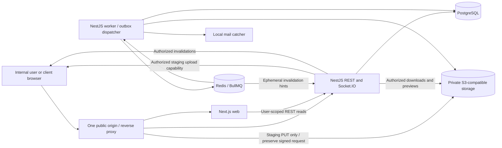

# Architecture baseline

Current authority, 2026-10-19: Phases 1–7 are accepted for their documented local-development scope. On 2026-10-19 the user explicitly authorized complete Phase 8 functional frontend integration across all 36 templates. Preserve prior storage, AppContainer/ACL, cleanup and operator-recovery limitations. Stop at the Phase 8 review gate; Phase 9 and professional design require separate authorization.

Status: reconciled architecture baseline, 2026-10-15. The user provisionally accepts the established architecture direction; the reconciled product/lifecycle defaults are approved for implementation planning and Phase 1 is authorized. Foundation implementation and experiments are recorded in docs/PHASE_1_REPORT.md; technical gates remain evidence-dependent. Source review supports proposals, not compatibility certification. Product policy is defined in [PRODUCT_SPEC.md](PRODUCT_SPEC.md); database ownership and security are detailed in [DATA_MODEL.md](DATA_MODEL.md) and [SECURITY.md](SECURITY.md).

## System shape and boundaries

Use a modular monolith with one domain model and database. Web, API, and worker are separate processes in one repository/release family; they are not independently owned microservices. Shared code does not grant workers unrestricted business permissions.

Browser traffic uses the single local application origin `https://localhost:8443`. The existing reverse proxy routes web, API/auth, Socket.IO, and a strictly limited staging-upload path. Upload bytes bypass NestJS and stream through that proxy to the private S3 service; “direct browser-to-storage” means this data path, not a second public storage origin. Downloads/previews go through authorized API streaming. Buckets remain private and the S3 service has no published host port.

### Concrete local-development routing

| Browser-visible route at `https://localhost:8443` | Private destination | Allowed behavior |
| --- | --- | --- |
| `/api/v1/*`, `/api/auth/*` | `api:3001` | REST and the selected auth adapter; exact auth mount verified in V01 |
| `/socket.io/*` | `api:3001` | Socket.IO handshake/polling/upgrade with session and Origin validation |
| `/dw-staging/<opaque-key>?<signature>` | `s3:9000`, same path/query | Only bounded presigned PUT to the private `dw-staging` bucket; no GET/HEAD/DELETE/POST/list/admin access |
| Other application routes/assets | `web:3000` | Next.js; reserved storage/admin routes are denied rather than proxied |

Propose one Compose network containing proxy/web/API/worker and the existing infrastructure. Only the proxy exposes loopback port 8443. API/worker access S3, PostgreSQL and Redis on private service names; the worker has no inbound public port. Keep local mail/service administration private and use approved local operator access when needed. TLS certificates/configuration stay project-local; actual browser/test trust behavior is a V01 setup check, not a claim that HTTPS is configured now.

The API's browser-upload signer uses the external endpoint `https://localhost:8443`, path-style addressing and bucket `dw-staging`. Its internal storage client uses `http://s3:9000`. Do not generate an internal URL and rewrite it afterward. The proxy must preserve signed Host (including port), exact path, query parameters and signed headers to S3 without stripping a prefix, changing the body or redirecting. Require signed checksum/type and `If-None-Match: *` conditions, enforce a transport byte cap, strip Cookie headers before storage, disable query-string access logging, and return no-store responses. Browser upload uses credentials omitted; its scoped signature is the credential. Only the API can mint intents/capabilities after normal session, resource and CSRF checks.

The upload route accepts the exact application Origin only and denies missing/foreign Origin for this browser flow. Same-origin traffic needs no cross-origin CORS grant; no wildcard CORS or second public storage hostname is configured. Origin/CORS checks supplement the signed capability and private bucket policy; they cannot replace authentication. Replay/expiry/type/size/source guarantees and proxy signature preservation must pass V03/T07/T08 against the chosen local S3 server.

This topology is our design proposal. [S3 signing documentation](https://docs.aws.amazon.com/AmazonS3/latest/developerguide/sigv4-query-string-auth.html) includes Host and signed headers in signature validation; [S3 CORS documentation](https://docs.aws.amazon.com/AmazonS3/latest/userguide/cors.html) distinguishes browser origin rules from bucket access policy. These sources do not establish local-server compatibility.

### Proposed repository structure

| Path | Responsibility | Allowed dependencies |
| --- | --- | --- |
| `apps/web` | Next.js App Router, semantic views, forms, annotation canvas/SVG overlay, navigation, user-scoped API adapter | Contracts and browser-safe config; never Prisma/server packages |
| `apps/api` | NestJS Express bootstrap, REST/auth controllers, gateways, OpenAPI, request context | Server, database, contracts, config |
| `apps/worker` | NestJS application context, outbox polling, BullMQ processors, scan/preview/mail/reconciliation handlers | Server interfaces, database, config; no web imports |
| `packages/server` | Domain modules, application use cases, authorization policies, infrastructure ports/adapters; server-only | Database and contracts as appropriate; no Next.js UI |
| `packages/database` | Prisma model/client factory, tenant unit of work, SQL migrations, RLS/constraint scripts, fixtures for tests | Server runtime only; no request globals |
| `packages/contracts` | Published OpenAPI snapshot and generated browser-safe DTO/client types; event envelope schemas | No ORM/domain entities or secrets |
| `packages/config` | Pinned shared TypeScript/lint/test settings; explicit browser/server config boundaries | No runtime secret export to web |
| `infra` | Compose, local proxy, service configuration, operating/runbook notes | Local free services only |
| `docs` | Product, architecture decisions, security, phases, evidence/traceability | Documentation |

These package paths now exist in the authorized Phase 1 foundation; the domain modules below remain planned. The pinned pnpm workspace and lockfile are reviewable and uncommitted. Prefer package scripts and filtering over another orchestrator. Exact versions and actual execution are in the Phase 1 report; configuration alone does not prove infrastructure compatibility.

### Domain modules

| Module | Owns and exports | Boundary rules |
| --- | --- | --- |
| Identity | Global users, credentials, sessions, verification/recovery, own profile image reference and notification preferences | Does not decide tenant/project permissions; auth library stays behind an adapter; self-owned media is not assigned a fake tenant |
| Organizations | Tenant, internal memberships, invitations/onboarding, settings including description/logo reference | Creates first Owner atomically; Access consumes membership facts; Files validates ready logo ownership |
| Access | Principal resolution, project assignments, client project grants, policy evaluation | No UI role checks as security; imports narrow membership/client query interfaces |
| Clients | Tenant client records and client contact identities | A contact is not an organization member or project grant |
| Projects | Project metadata, client association, lifecycle, portal enablement | Owns lifecycle transitions; asks task/review modules for completion checks |
| Work | Milestones/tasks, priority, assignment/order/deadlines, checklist items, internal task comments and history | Owns task-create permission and idempotent feedback conversion through a Reviews read port; all links stay in one tenant/project |
| Files | Flat logical project folders, upload intents, quarantine, canonical metadata, scan/preview and authorized streams; logo/profile processing | Shares one processing pipeline with distinct project/organization/account repositories and policies; no universal nullable-tenant escape hatch |
| Deliverables | Mandatory project/optional task relationship, latest-prepared pointer, immutable versions, explicit shares | Preparation/sharing never supersedes a review; Reviews orchestrates deliberate atomic replacement |
| Reviews | Cycles, participants, feedback/annotations, exact-version decisions/approvals and explicit active-review replacement | Target is fixed per cycle and independent of latest-prepared pointer; exports a scoped source-feedback read port to Work |
| Collaboration | Internal discussions and basic rich-text project documents with optimistic revisions | Bounded allowlisted structured content and safe rendering; no client document access or collaborative editing engine |
| Communications | Per-recipient optional notifications respecting account preferences, invalidations, aggregate client updates | Permission-filter before aggregation/delivery; mandatory identity messages bypass optional preferences; rooms never confer authority |
| History | Append-only sensitive audit events and project activity projections | Audit is authoritative evidence; activity is a user-facing projection |
| Reporting | Scoped read queries and metric calculations | No mutable business state, cross-tenant warehouse, or separate reporting database |
| Platform events | Outbox, handler receipts, retry/reconciliation infrastructure | Transport contains IDs; handlers reload trusted scoped state |

Modules call exported application services/ports instead of reaching into another module's repository. Cross-module atomic workflows use one transaction/unit-of-work passed explicitly to participants. Avoid circular imports: Projects orchestrates lifecycle queries through ports; Reviews orchestrates active-review replacement with Deliverables/Access read ports; Work converts feedback through a narrow Reviews source port. Preparation never calls supersession. Participants reuse the same unit of work instead of opening nested transactions. Business decisions stay out of controllers, gateways, React components, and job wrappers.

## Authentication evaluation and provisional recommendation

| Candidate | Fit | Material tradeoff | Baseline position |
| --- | --- | --- | --- |
| Better Auth in NestJS with Prisma persistence | Reusable email/password/session lifecycle and documented Next.js integration | Community Nest adapter; requested isolated checks now pass with the documented session policy and one-time proof receipt | V01 scoped compatibility PASS; production identity remains unimplemented |
| NestJS Express + Passport + `express-session` + PostgreSQL store | Documented NestJS session middleware and a small server-owned session boundary | Application must assemble/review verification, recovery, invitation binding, CSRF, and session lifecycle; more security ownership | Fallback only after a decision review and equivalent tests |
| Next.js-owned auth with a second API token/session system | Strong Next.js ecosystem | Creates two trust/session boundaries and server-to-server credential propagation | Not selected |
| Paid hosted identity provider | Potentially reduces some operational work | Conflicts with free/local-first scope and adds external dependency | Not selected |

Propose Better Auth as the sole API-owned identity authority, database-backed opaque cookie sessions, local email/password, and verified-email lifecycle. Disable client cookie-session caching for authoritative authorization. Next.js sends credentials to the API and calls its session endpoint for server-rendered private reads; it does not instantiate a second auth authority or read the database. The adapter's auth routes may have a library-required prefix; document them separately from versioned business routes in OpenAPI.

This recommendation is an architectural inference from official docs. [Better Auth's NestJS guide](https://better-auth.com/docs/integrations/nestjs) labels its adapter community maintained and describes body-parser requirements. [Its Next.js guide](https://better-auth.com/docs/integrations/next) describes client/server integration. [Its session guide](https://better-auth.com/docs/concepts/session-management) describes the configurable session lifecycle. The [NestJS session guide](https://docs.nestjs.com/techniques/session) supports the fallback and warns against default memory storage. Neither source review nor a documented adapter proves our pinned stack works.

## Persistence and tenant unit of work

PostgreSQL is the source of truth for identity, tenancy, delivery, decisions, audit, and durable event intents. Redis contains expendable queue/runtime state, not approvals or authoritative permissions. Files are external bytes referenced by database metadata; database and object storage cannot commit atomically.

Every tenant use case receives an authenticated principal and explicit tenant context. A tenant unit of work opens a database transaction, sets parameterized transaction-local organization context on the same connection, and exposes only that transaction's scoped repositories. Nested helpers reuse it. No database call may escape to a global client while inside that boundary. Workers use the same mechanism with an allowlisted system purpose. A missing context denies tenant reads/writes.

Use application filters plus composite foreign keys plus tenant RLS. RLS does not replace membership/resource/field policies. Runtime roles are nonowners and lack superuser/BYPASSRLS/DDL rights. Identity tables and the outbox dispatch mechanism use deliberately separate narrow access; see the security document. Connection pool, transaction context, raw SQL, and migrations must be tested with the actual pinned Prisma version. [PostgreSQL RLS documentation](https://www.postgresql.org/docs/current/ddl-rowsecurity.html) explains policy/default-deny behavior and role bypasses. [Prisma transaction documentation](https://www.prisma.io/docs/orm/prisma-client/queries/transactions) is version-sensitive; do not copy APIs from an unpinned documentation version.

Use database uniqueness, checks, partial indexes, immutable-row triggers, row locks, and compare-and-swap revisions where an ORM cannot express a guarantee. Preserve manual SQL in reviewed migrations with integration tests; introspection/schema generation must not silently drop it. No long-running database transaction includes upload transfer, scanning, preview rendering, SMTP, or queue network calls.

## Key data flows

### Ordinary mutation

1. Validate session and selected capacity, request shape, origin/CSRF, and idempotency/precondition where applicable.
2. Open tenant transaction; load and authorize resource ancestry and current role/lifecycle. Lock relevant aggregate and permission records for sensitive transitions.
3. Persist domain state plus sensitive audit record plus important outbox event in the same transaction. Return a versioned public DTO only after commit.
4. An outbox dispatcher enqueues the committed event. Consumers create notification/activity projections or processing work idempotently. The UI may refetch on a scoped invalidation; the HTTP response is authoritative for the mutation.

### Upload to immutable deliverable version

1. An authorized internal user creates a bounded project upload intent with purpose, checksum and size/type limits; optional folder affects only the ProjectFile listing. Separate organization-logo/account-profile commands use the same pipeline under their own ownership checks. API returns a short-lived staging-only capability signed for the public application origin.
2. Browser PUTs to the same-origin staging path; the reverse proxy streams the unchanged signed request to private S3, bypassing NestJS. Write-once conditions protect the source. Completion requests verification; it cannot declare bytes safe.
3. A worker rechecks intent/source identity, streams bytes for actual checksum/type/size, scans in isolation, renders safe bounded previews, and creates a unique canonical private object using no-overwrite semantics. Failed/malicious input remains unavailable.
4. Persist `FileAsset READY` only after canonical object identity, digest, and expected previews are verified. No version exists for pending uploads. A crash after object creation is repaired by a deterministic job receipt/reconciliation; unattached objects can later be reclaimed conservatively.
5. A version command locks the Deliverable and relevant access state, validates the ready project asset, allocates N+1, inserts immutable metadata, updates only the latest-prepared pointer, and writes audit/outbox. It does not modify an existing review or its eligibility. Task linkage is optional and, if supplied, must match the deliverable's tenant/project. Sharing, opening and replacing a review are explicit separate commands.

The canonical key is never handed out for browser writes. Staging conditional-write and canonical identity guarantees must be demonstrated against the chosen local S3 implementation. [S3 presigned URL documentation](https://docs.aws.amazon.com/AmazonS3/latest/userguide/using-presigned-url.html) notes that upload URLs can be reused and existing keys replaced. [S3 conditional-write documentation](https://docs.aws.amazon.com/AmazonS3/latest/userguide/conditional-writes.html) describes overwrite preconditions. Those AWS guarantees do not certify a compatible local server; V03 is mandatory.

### Review decision, preparation and deliberate replacement

A decision includes the displayed review ID, version ID/digest, expected review revision, decision and idempotency key. Within the shared lock order, check live session/principal, project grant, portal/share/file state, frozen participant eligibility, OPEN cycle and its immutable target. Do not compare the target with `latest_version_id`: preparing/sharing N+1 and deciding N are independent valid operations. Persist the sole immutable decision/Approval and audit/outbox atomically.

A Manager's explicit replacement command names the expected OPEN source cycle/revision and a newer ready, available, already shared, never-approved version of that same Deliverable with its digest and a new eligible roster. In one transaction, recheck all authority/state, set the old cycle to SUPERSEDED, insert the new OPEN cycle, and record linked audit/outbox events. The one-open-cycle constraint remains. No version-level draft/published state machine is added.

Replacement and a decision serialize on the same Project/access/Deliverable/Review locks. If replacement wins, the old decision conflicts; if the decision wins, replacement conflicts without opening anything. The Manager must reload and explicitly open a new cycle afterward. Repeated replacement keys return the same authorized result; different competing replacements cannot create two open cycles. Failure rolls back both sides. Historical bytes, approvals, feedback and shares remain; no retargeting or automatic approval carry-forward.

### Feedback-to-task and restored functional boundaries

Work exposes an authorized Manager/O/A conversion command taking a feedback-thread ID and ordinary task fields. It loads readable feedback through a scoped Reviews port, checks that the target is the same active project and the assignee/milestone are valid, then inserts Task with an immutable source-thread reference, TaskHistoryEvent, audit/outbox and idempotency receipt in one unit of work. A permanent unique source-thread constraint allows one converted task even across different retry keys. Closed-cycle feedback can be a source; conversion does not modify the thread or decision. Client DTOs/events contain no task ID, link or conversion marker.

Task checklist, comment and history operations stay in Work; task history is available in Phase 3 before the Phase 7 project-activity browser. Flat ProjectFolder metadata never changes storage paths, file identity or inherited access. Rich-text document content is a small versioned allowlisted JSON structure (paragraphs/headings/text, ordered/unordered lists, bold/italic and safe links), validated on write and safely rendered through explicit components. A minimal toolbar-based visual editor implements the formats; no large editor/collaboration service is required.

Organization logos use tenant-owned non-project media records; profile images use separate global self-owned records behind Identity/Files. Reuse storage/scanning/rendering code, but keep upload purposes, tables, credentials and policy paths distinct. Organization media uses tenant outbox; self-owned media uses a narrow identity-event outbox/receipt path on the same PostgreSQL/BullMQ infrastructure. A worker revalidates trusted owner/purpose context and never gains arbitrary user access. Logo/profile attachment happens only after a clean image is READY; replacements do not mutate existing bytes.

Account preferences control optional in-app categories when Communications materializes notifications through a narrow Identity preference-read port for already-authorized recipients; they do not affect required identity/security messages or resource access. The client-update query unions only permitted published updates/shared review milestones across the active client's accessible projects, then applies filters/cursors/counts. Project context is an optional filter on P36, not a new page.

### Real-time delivery

Socket.IO authenticates the server-side session and checks Origin on handshake; each subscription/event rechecks tenant and resource access. Since [Socket.IO middleware](https://socket.io/docs/v4/middlewares/) runs once per connection, handshake authorization alone is insufficient. Use server-generated rooms and small invalidation events rather than raw content. Revalidate the current recipient before emitting, including after grant/session revocation. Clients reload permitted data via REST. Business writes remain REST commands so all clients share one contract and idempotency path.

After a worker commits a durable notification/projection and receipt, it publishes a minimal invalidation hint over a private Redis pub/sub channel. The API subscribes, validates event/recipient references, rechecks the live session/resource policy, then emits to eligible sockets. Queue consumers never reach into a gateway instance or broadcast raw domain payloads. The API also uses Redis for bounded rate-limit state. Pub/sub hints are expendable: a missed hint or API restart is recovered by REST refetch on reconnect/navigation and periodic bounded refresh; notification records/outbox completion remain durable in PostgreSQL. This initial single-gateway handoff does not require a distributed Socket.IO adapter.

### Outbox and worker recovery

- Persist a typed event envelope with event ID, scope, aggregate ID/revision, type/schema version, time, actor, correlation ID and minimal payload. Tenant events require organization; separate identity events require a validated owner/purpose. No nullable-tenant fallback, credentials or signed links.
- Poll/lease committed rows in bounded batches. Enqueue with stable job IDs; a crash between enqueue and acknowledgement can duplicate delivery. Consumers use durable unique `(handler, event_id)` receipts and domain-specific unique keys. Mark dispatch acknowledged only after queue acceptance.
- Queue acceptance alone is not processing completion. Retain PostgreSQL consumer completion/attempt state and reconcile dispatched-but-uncompleted events after timeouts or Redis data loss. Manual replay uses the same idempotency path.
- Use capped exponential backoff with jitter, attempt budgets, terminal-failure records, and visibility for local operators. Never silently drop scan/notification failures. Per-aggregate revisions allow projections to reject stale events and rebuild/reload authoritative state.
- No exactly-once claim: durable outbox/consumer delivery is at least once; ephemeral socket hints are best effort. Keep jobs narrow and idempotent, consistent with [BullMQ's idempotent-job guidance](https://docs.bullmq.io/patterns/idempotent-jobs). A mail send can succeed before its receipt commits; document possible duplicate mail and ensure one-time links remain safe.

## REST and contract conventions

- Business base path: `/api/v1`. Tenant paths use `/organizations/:orgId/...`; nested project IDs must match loaded ancestry. Public identity/auth paths are explicitly allowlisted. `/me` endpoints operate on the authenticated identity, not supplied user IDs.
- Request DTOs whitelist writable fields; reject unknown authority/tenant fields. Use opaque IDs, ISO-8601 UTC instants, server-assigned actor/tenant metadata, and explicit enum values. Never serialize session rows or ORM entities.
- Lists return `{ items, nextCursor }`; cap page size, validate filters, use stable `(created_at, id)` ordering or explicit task order with a tie breaker. Apply authorization before pagination, counts, and aggregates.
- Errors use `application/problem+json`: stable type/code, title, HTTP status, safe detail, instance/request ID, and validation fields when safe. Use 401 for invalid session, 403 for an established but forbidden action, 404 for inaccessible/nonexistent resource identity, 409 for domain conflict, 412 for stale `If-Match`, 413/415 for upload limits/type, 429 for throttling. Do not leak another tenant's record through error detail.
- Creation returns 201; accepted asynchronous processing returns 202 with a scoped status resource; 200/204 for successful transitions. No state-changing GETs.
- Use an integer `revision`/ETag on editable aggregates and `If-Match` on updates. Mandatory idempotency keys cover onboarding, invitation acceptance, upload completion/attachment, version creation, review opening/replacement/decision, and feedback-to-task conversion. Scope keys by actor capacity, tenant (or self-owned identity scope), operation/target and canonical request hash; mismatch gives 409. Recheck access before returning a stored result. Proposed retention is 24 hours, with permanent uniqueness for decisions, conversions and other durable facts.
- Generate OpenAPI from reviewed REST DTOs; commit a snapshot and generated client types. Document auth-handler endpoints even when library-owned. Contract tests detect drift and security metadata omissions.
- Protected server-rendered web reads forward only the intended cookies/request context to the configured API host, use no shared caching, and cannot mint trust headers. Mutations call API routes directly; any future Next.js action is a transport adapter with the same CSRF/error contract. Public assets can be cached; private data must not be statically generated or shared across users.

## Local infrastructure and operations

Planned Compose roles remain proxy, web/API/worker, PostgreSQL, Redis, a validated private S3-compatible server, local SMTP catcher and bounded malware scanner. Use the concrete single-origin routing above; no separate public storage endpoint or new service is needed for restored features. Select free images/licenses and verify Windows/Docker/TLS support before pinning; no provider accounts or paid resources. Only later explicit phase authorization permits startup.

Use separate DB credentials for migrations, tenant API, worker, auth, and outbox dispatcher. Restrict dispatcher's cross-tenant outbox operations to a narrow interface, not unrestricted domain queries. Private file finalization credentials are worker-only; API can authorize staging and read canonical objects, but cannot replace canonical bytes. Keep Redis private and deny public administrative endpoints.

Operational controls: structured request/job correlation, health/readiness without secrets, database migration checks, outbox age/failure metrics, worker attempt visibility, scan resource limits, conservative orphan reconciliation, and backup/restore rehearsal before functional completion. A development instance is not production-ready merely because Compose starts. One API gateway process is sufficient initially; evaluate Redis Socket.IO adapter and sticky sessions only when scaling is demonstrated necessary.

## Provisional decision register

The architecture direction is accepted for implementation planning. D06, D07 and D12 retain the reconciled lifecycle/topology/document decisions; implementation remains subject to V01–V08. Phase 1 is authorized and its current execution record below states what actually passed. Phase 2 is not authorized.

| ID | Decision and rationale | Consequence / validation |
| --- | --- | --- |
| D01 | Modular monolith with API/web/worker processes; keep one transactional domain | Shared releases and disciplined module ports; no microservices/Kafka/Kubernetes |
| D02 | pnpm + TypeScript; Next.js/React and NestJS Express | Pin mutually supported versions in V01; Express minimizes auth adapter uncertainty |
| D03 | PostgreSQL/Prisma with reviewed SQL integrity and RLS | Prisma is not the sole schema authority; V02 must prove transaction and migration behavior |
| D04 | Better Auth API-owned DB sessions; one origin | Requested V01 checks PASS with supported session hooks, database idle/absolute policy and one-time verification receipt; production adoption remains a separate Phase 2 review, fallback requires explicit ADR |
| D05 | RBAC plus project/resource/field/state policy; explicit client grants | More policy tests, no role-only shortcut; Phase 2 gate |
| D06 | Immutable versions and separate sharing; any-one named Approver retained; prepare independently, replace active review deliberately | Replaces supersede-on-create policy; fixed cycle targets, atomic replacement, no carry-forward; V04/T09–T11 and product review |
| D07 | Single HTTPS application origin; proxy staging-only signed PUT to private S3; no-overwrite canonical storage and API reads | Resolves topology ambiguity without another public origin/service; separate media owner scopes share pipeline; V03/V05 |
| D08 | Transactional outbox and idempotent BullMQ consumers | Eventual projections, duplicate handling, Redis-loss reconciliation; V06 |
| D09 | REST authoritative; Socket.IO sends authorized invalidations | No second mutation API or room-based trust; V07 |
| D10 | Minimal Next.js UI per slice, all 36 functional before design | Phase 8 integrates rather than postpones all UI; Phase 9 blocks redesign |
| D11 | Free native Windows development infrastructure; Compose optional; no paid external dependencies | Exact binaries/licenses and real queue/S3/SMTP/restart evidence in the native report; product V03/V05/V06/V08 guarantees retain later gates |
| D12 | Basic rich-text documents with safe structured content; scoped live reports; flat folders and optional same-project deliverable/task link | Restores required function with existing modules/pages; no collaborative editor, cloud drive, or warehouse |
| D13 | Phase 2 adopts pinned Better Auth 1.7.10 with its Prisma adapter; raw library handler is not mounted in product mode. Versioned Identity commands enforce explicit Origin plus session-bound CSRF and return sanitized generated DTOs. | Same vetted credential authority as V01; separate product schema/cookie, UTC connections, 8h absolute/30m idle/10m recent-auth, digest verification receipts and hashed recovery identifiers. No fallback or dependency upgrade. |
| D14 | Add `devworkspace_phase2` in the retained native PostgreSQL cluster, preserving `devworkspace_v01` and all Phase 1 files/data. Use checked-in additive SQL migrations, a checksummed migration ledger and separate nonowner runtime roles. | Prisma generates auth/tenant clients; reviewed SQL owns additional constraints, forced RLS, restricted bootstrap/resolver/dispatcher functions and deferred last-owner checks. V02 real pooled/nested/raw/rollback/fresh-database tests pass. |
| D15 | Persist mail as AES-256-GCM envelopes in dedicated identity/tenant mail records; outbox/queue payloads contain references only. Wrap auth mutations in the pinned core transaction context so credentials, audit, proof and mail/event intents commit together. | The pinned library catches mail callback errors: a per-operation AsyncLocalStorage failure flag forces rollback and a recoverable 503. This uses its pinned `@better-auth/core/context` advanced API; updates require the fault-injection suite. Verification claims retain V01 fail-closed semantics if a later operation fails. |
| D16 | Membership privilege changes revoke affected sessions in the same transaction, including first-owner bootstrap and invitation acceptance. Users reauthenticate to receive fresh sessions. | Stronger revocation avoids retaining privilege-transition sessions. Organization-row serialization and a deferred last-owner constraint protect parallel changes, including stale MVCC snapshots. UI explicitly returns users to sign-in after onboarding/acceptance/transfer. |
| D17 | Phase 2 identity abuse counters use a restricted atomic PostgreSQL function, shared across API processes; Redis/BullMQ continue to own expendable transport. | Compared with the earlier proposed Redis rate adapter, this avoids coupling login/recovery availability or quotas to queue state and requires no API Redis credential. Windows-native architecture/pins are unchanged. Both identity and IP windows reset each minute; no permanent lockout. Counters contain hashes only; retention/maintenance remains subject to V08 rather than an implicit data purge. Tests prove cross-process quota enforcement. |

For changes, record status/date, alternatives, decision owner/review, rationale, consequences, affected FR/page IDs, migration impact, and evidence links here or in a linked ADR. Never silently swap an auth/storage/approval policy.

## Validation and risk register

| ID | Open question / risk | Required evidence and deadline |
| --- | --- | --- |
| V01 | Exact stable Node/pnpm/Next/React/Nest/Prisma/Better Auth/adapter matrix; auth route/body-parser/cookie/CSRF behavior; session storage and reset revocation; Next.js private reads and gateway reuse | Phase 1 isolated compatibility report with exact versions/official release sources and passing/failing checks; no assumption of end-to-end product support |
| V02 | Prisma transaction connection affinity, RLS context cleanup, nested relations/raw SQL, custom SQL migration preservation, narrow identity/dispatch roles | Phase 2 real PostgreSQL tests with nonowner runtime roles, pool reuse and rollback; blocks domain CRUD |
| V03 | Local S3 implementation; same-origin path-style signing/proxy Host/path/query/header preservation; private bucket/method/Origin restrictions; no-overwrite/checksums/ranges/reconciliation | Phase 1 document candidate/topology; Phase 4 prove real behavior, including project/logo/profile scopes; no inference of compatibility from AWS docs |
| V04 | Any-one approval retained; prepare/share independent of deliberate replacement; optional task relationship and one feedback-conversion task; grant/share/lifecycle policies | Revised product review plus Phase 3–5 ancestry/concurrency tests; replacement/decision race differs from preparation/decision race; no quorum engine |
| V05 | Scanner/PDF/image tool choice, license/isolation, project/media byte/pixel limits, safe logo/profile processing and annotation geometry | Phase 1 identify candidates; Phase 4/5 hostile fixtures, proxy upload/media ownership and working annotation evidence |
| V06 | Outbox leases, idempotent handlers, Redis-loss recovery and mail crash ambiguity | Phase 6 fault-injection evidence, with earlier outbox tests from Phase 2 |
| V07 | Mid-connection revocation and no stale recipient payload leakage | Phase 6 authenticated/unauthorized socket tests, including late events, expiry and reconnect |
| V08 | Retention/deletion of project and branding/profile media, redaction, restore, local resource budgets | Defaults reviewed before Phase 4 cleanup; no purge of referenced history/active images; recovery evidence by Phase 9 |

## Requirement tensions and resolution

No unavoidable contradiction is identified in the requested architecture. These tensions require deliberate implementation:

- Backend-first coexists with mandatory interactive annotations and incremental integration: each functional phase includes thin UI, and Phase 8 completes cross-module integration.
- Full scope includes the seven expansion pages: Phase 7 implements them before system verification and redesign.
- Shared PostgreSQL plus tenant RLS does not isolate clients within one tenant: Access policies and client-specific DTOs supply that boundary. Global identity and dispatch need narrow documented exceptions, not blanket RLS bypass.
- Immutable approved bytes coexist with review continuity and security revocation: prepared versions never retarget open cycles; explicit replacement changes cycle state atomically, and access/processing changes cannot rewrite historical content or decisions.
- Architectural simplicity still needs worker, scanner, Redis, and storage: they directly support required files/reliability; additional orchestration and distributed services are deferred.
- The user has restored task detail/conversion, flat folders, rich text, settings media/preferences and aggregate updates. These fit existing modules and 36 templates. Revised default policies and limits are visible in the product specification; exact dependency compatibility, RLS, storage, scanning and recovery remain unverified behind existing gates.

Foundation and gap-closure work remain limited to Phase 1 in [IMPLEMENTATION_PLAN.md](IMPLEMENTATION_PLAN.md). The remaining infrastructure execution gate blocks its full exit; Phase 2 requires separate explicit authorization.

### Feedback-to-task duplicate contract

For the same authorized actor/scope, the same idempotency key and matching payload replay the original result after authorization. A reused key with a different payload returns 409 Conflict. The same source thread with a different key returns 409 Conflict; include an existing-task reference only if that actor is still authorized to see that task. Client principals never receive internal task references. Permanent source uniqueness and transaction/concurrency protection remain mandatory. This is a Phase 5 contract, not Phase 1 application functionality.

## Phase 1 execution record

### Native Windows infrastructure decision (2026-10-16)

The user approved replacing the mandatory local Compose execution gate with real
native Windows service validation. Keep Next.js, NestJS, Prisma/PostgreSQL,
Socket.IO, BullMQ and private S3 interfaces unchanged. Use the retained project
PostgreSQL cluster; evaluate Memurai Developer 4.1.7 (Redis API 7.2.11) against
pinned BullMQ 6.3.15; run official Windows SeaweedFS 4.48 and Mailpit 1.31.6 binaries
from ignored project-owned D: paths. No global PATH edits, automatic services or
Docker/WSL are required. This is an infrastructure execution decision, not product
functionality or authorization for Phase 2.

Alternatives considered: Docker/WSL was explicitly cancelled; obsolete unofficial
Windows Redis builds were avoided; replacing BullMQ with a PostgreSQL queue would
change the agreed architecture and is not part of this task. Native SeaweedFS and
Mailpit preserve the selected protocols and candidates. Memurai Developer is
proprietary, development/test-only, and requires restart after ten days; it is not
a production Redis selection. Its exact bundled license is retained with the
ignored vendor files, which must not be redistributed with this repository.

Consequences: all HTTP, SMTP and gRPC service/admin listeners must explicitly use
loopback; native process ownership, graceful shutdown, persistence and real
integration tests replace container-network assumptions. Local processes share
the Windows user's security boundary. Compose files/digests remain optional
documentation with Docker-specific runtime tests marked not executed.

Exact results, provenance and remaining later-phase guarantees are in the
[native validation report](PHASE_1_NATIVE_INFRASTRUCTURE_REPORT.md). Earlier
Compose-era execution notes below are historical evidence.

The [Phase 1 report](PHASE_1_REPORT.md) and [exact version/provenance record](DEPENDENCY_VERSIONS.md) supersede documentation-only status for foundation work. D01/D02 have a pinned monorepo and real build evidence. D04/V01 requested compatibility checks now PASS: 30-minute database-authoritative inactivity plus fixed eight-hour maximum, ten-minute recent-auth probe, verified-only login, actual email proof consumption, recovery expiry/replay, and races across two independent API processes. All original eight integration checks remain passing; the expanded suite has twenty checks. No production identity implementation or Phase 2 authorization is implied.

The supported Better Auth before hook verifies its signed cookie, then restricts the existing library session row through an atomic PostgreSQL activity/expiry policy. An after hook revokes the presented old same-user session on successful password reauthentication. Better Auth still owns credentials, tokens and sessions. Its default stateless verification JWT permits repeated success, so library-issued email proofs have a SHA-256 issuance/consumption receipt with an atomic database claim. Claims fail closed if a downstream operation fails; they do not pretend to be an atomic email-delivery transaction. The existing Prisma adapter runs with its supported transaction option. Timestamp comparisons explicitly normalize database time to UTC on the actual Africa/Cairo cluster. See the report for source references, measured failures/corrections and crash limitations.

The single-origin host proxy and PostgreSQL fixture ran; Docker/Redis/SeaweedFS/Mailpit remain configuration-only because Docker is absent. Staging rejection tests are not V03 storage proof. V02–V08 retain their original phase gates. Phase 2 remains unauthorized.

## D18 - Phase 3 domain serialization and access foundations

2026-10-16, within the user's complete Phase 3 authorization. Reuse the existing organization-row serialization boundary for all core reads/writes and live session/principal checks. Keep project roles distinct from organization membership; task assignees reference explicit project memberships, including for Owners/Admins. External contacts use a separate resolver and selected contact principal; affiliation never grants project access. Extend the existing encrypted invitation/mail/outbox lane with immutable client/project targets and actual verified acceptance.

The alternative of independent resource locks would allow greater parallelism but needs a wider revocation/assignment lock protocol. Retaining the existing lock order favors correctness at this stage and serializes unrelated work inside one organization. Measure before optimizing. No runtime role gains identity-table, migration, DDL or BYPASSRLS privileges. The NOLOGIN resolver receives explicit contact/project read policies only for its narrow self-principal interface.

Migrations 0010-0012 add tenant/project-qualified keys, forced RLS, append-only comments/history, assignment-clearing and milestone/completion backstops. Prisma contains scalar mappings; reviewed SQL remains the authority for composite FKs and triggers. Migration 0011 repairs polymorphic trigger field access with JSON extraction after 0010 was applied; no applied migration was edited. Domain policies and explicit DTO allowlists remain in `packages/server/src/core.ts`; API routing stays in the existing product adapter. Canonical public Phase 3 fields use snake_case, matching the reviewed domain names; they are explicit DTO projections, never `SELECT *` responses.

All core changes append an audit action and `core.changed` outbox intent atomically; task-specific history carries relevant changed fields and actor identity. No notification/activity consumer or general project activity page is claimed in this phase. The retained worker safely completes events without a mail payload. Client invitation acceptance uses the shared receipt contract and live issuer/contact/grant checks. Simple CRUD uses revisions rather than introducing an idempotency contract; onboarding/invitation acceptance retain mandatory keys. Feedback conversion remains Phase 5.

Evidence and known limitations: [Phase 3 report](PHASE_3_REPORT.md), `tests/phase3/core.test.mjs`, `tests/unit/phase3.test.mjs` and `tests/e2e/phase3.spec.ts`. Phase 4 requires a separate acceptance/authorization decision.

Phase 3 invitation mapping: one explicit project grant is proposed per client invitation using immutable columns on the retained Invitation record. Additional projects require separate explicit grants/invitations. Internal invitations keep organization membership separate from subsequent project participation. This preserves the approved capacity/ancestry semantics without a batch invitation interface or unused multi-grant table.

## D19 — Native isolated processing and immutable storage identities

2026-10-17, complete Phase 4 authorization plus explicit user approval for a per-user Windows 10 AppContainer and narrow ACL changes. Reuse organization serialization, restricted RLS roles, BullMQ transport and PostgreSQL durable jobs. Node permissions alone were rejected because they do not restrict network. The actual scanner/parser processes use a zero-capability AppContainer, credential-free environment, no inherited handles, Windows Job limits and bounded project-local work. Verified tools/CVDs are read/execute only; default AppContainer profile writes are denied. Host code transports, hashes and validates regular output files without decoding untrusted content. The disk monitor is sampled, not an atomic quota.

SeaweedFS 4.48 conditional PUTs and same-origin SigV4 pass actual tests. The tested AWS s3:if-none-match bucket-policy condition is unsupported and denied both conditional/unconditional writes. Adopt conditional creation plus immutable database-pinned S3 version IDs and canonical deletion-deny policy. A newer storage version cannot alter a pinned download. Object Lock-enabled bucket creation is retained; per-object legal holds are not claimed. Administrator credentials remain a trusted operator boundary. Separate API, processing and cleanup credentials and authenticated raw filer/volume endpoints close direct access paths.

READY follows verified digest/size, real scan, isolated decode/render, output bounds, canonical publication and exact-version read-back. Storage and SQL completion are separate: deterministic keys and digest checks support interrupted retry. Asset/version records are immutable; separate availability permits denial without rewriting history. Append-only processing steps carry lease, tool identity and outcome; content-addressed tool manifests retain prior signature identities. Separate project/logo/profile tables preserve tenant/self ownership; profile events use the existing identity lane. A database-wide processing lock and queue backpressure serialize worker instances. The work root is read/execute only to the package; each job has writable contents but cannot delete its own directory or create siblings. Any crash residue blocks the next parser until operator recovery, preserving tenant isolation across the reused profile.

The approved V08 subset deletes only exact expired unattached staging keys after a 24-hour grace period. Hold the upload row lock across ownership/reference/job/lifecycle checks, deletion and audit/tombstone commit. Unused/expired/rejected/exhausted intents may qualify; active jobs, canonical assets, immutable versions and active images cannot. A crash after remote success retries 404 and records one tombstone. Full canonical retention/backup/restore remains later. See [Phase 4 evidence](PHASE_4_REPORT.md) and [runbook](../infra/README.md).

## D20 — Exact-version review and separate client authority

2026-10-17, full Phase 5 authorization after acceptance of Phases 1–4 for their documented local scope. Keep the organization-row lock for internal/client review, decisions, explicit replacement, sharing, grants and source conversion. Immutable version reads use SELECT under that boundary; granting UPDATE merely to lock immutable history was rejected. One OPEN cycle per deliverable and permanent source/decision/version uniqueness supplement application policies. Roster eligibility is frozen at creation but current contact/grant/verified identity is revalidated; a separate tenant-scoped boolean client eligibility function avoids creating internal membership.

Additive 0021–0027, deferred cycle/decision/approval consistency, source-qualified FKs and append-only history preserve exact attribution. Preparation/sharing is independent of replacement. Normalized canonical image/PDF points use verified preview dimensions and inverse quarter-turn display transforms. Reusing private derived PNG previews avoids introducing another browser parser/dependency. No original bytes are edited. Scoped operation receipts replay after live authorization; SQL/source uniqueness outlives any future receipt retention policy. Conversion calls the existing Work task use case in the same transaction, so assignment/lifecycle/history rules are reused.

Resource lifecycle cancellation is a database trigger in 0027, so project portal disable/archive, deliverable archive and share revocation share the same transaction and organization lock as the underlying mutation. Cancellation records its own audit/outbox effects using transaction-local actor, principal and request context; a missing context or event failure aborts the entire mutation. Re-enable/re-share does not reopen a terminal cycle. Completion requires no OPEN reviews as well as the existing task condition. Opening/replacing validates the supplied exact digest and ACTIVE project/portal/target eligibility.

Alternative independent resource locks would improve throughput but require a complete shared revocation ordering; deferred until measured demand. Alternatives that retarget the latest version, require unanimous contacts, confer internal roles on clients, or copy annotations to revisions contradict the accepted product. Notifications/sockets remain Phase 6; this phase emits durable review events through the existing outbox. Verification, known failures and storage/recovery limits: [Phase 5 report](PHASE_5_REPORT.md).

## D21 — Recipient-scoped notifications, durable effects and authorized realtime

2026-10-18, full Phase 6 authorization after acceptance of Phases 1–5. FR12/FR18/FR19, P14/P31 and shared portal/internal indicators. Keep the existing tenant/identity outbox and BullMQ transport; add schema-6 resource/assignment snapshots only to new envelopes. One SQL policy port evaluates current recipient/resource visibility for materialization, RLS reads/counts and gateway emissions. A separate NOLOGIN/NOBYPASSRLS communications purpose role owns fixed-search-path interfaces; login worker/dispatcher roles receive no direct notification, preference or domain access. Global self preferences use actual-session-bound functions and per-user locks; materialization checks permission before preference and commits its receipt with effects. Completion requires that durable receipt, independent of expendable Redis hints.

Assignment notices follow the event's project assignee only while still assigned/currently authorized. Review/version events reach current internal readers and only explicitly safe client actions on available shared exact versions; no private content is copied. Stored links never confer authority. A source-envelope insert guard and recipient/event/capacity/category uniqueness preserve ancestry and retries. Historical event envelopes are not backfilled. Unmapped events get handled receipts; later Phase 7 categories wait for their actual sources.

Socket.IO authenticates an actual session and strict selected capacity, validates subscriptions, derives room names and revalidates each emission plus bounded one-second connection checks. Worker hints use private Redis pub/sub after commit; each gateway reloads trusted references and applies live checks before minimal invalidations. REST refetch on connect/navigation/manual action and bounded periodic refresh recover missed hints. Existing independent API processes prove shared revocation/fanout without granting room-based authority or requiring a distributed adapter.

Alternative browser polling alone would omit V07; raw domain broadcasts/authorization caches would leak after revocation. A second queue/event system, optional email channel and Phase 7 categories were rejected as outside scope. Existing ioredis 5.8.2 and socket.io-client 4.8.4 pins are wired into API/web manifests from the offline cache; no version upgrade/new binary/service. Organization serialization remains the conservative ordering boundary. SQL 0028–0034 and the [Phase 6 report](PHASE_6_REPORT.md) record verification, corrective forward migrations, backoff/replay and inherited recovery limits. No exactly-once SMTP, full restore, load or final-system certification is claimed.

## D22 — Phase 7 collaboration and scoped expansion reads

2026-10-18, complete Phase 7 authorization after accepted Phases 1–6 and the passing post-0034 preflight. Reuse organization serialization, selected-principal policy, restricted unit of work, tenant outbox, communications purpose and lease-bound materializer. Discussions/documents stay internal; client updates are explicit publications with withdrawal. Audit browsing is O/A-only. Reports distinguish scoped live state from terminal UTC-window events. No BI store, editor service or alternative event/storage/auth system is introduced.

Documents use bounded version-1 blocks and bold/italic/HTTP(S) text marks, escaped rendering and a native visual toolbar. Paste becomes text; SQL supplements DTO validation and CAS conflicts retain drafts. This avoids editor dependencies/arbitrary HTML; no collaborative engine is implied. Activity is unique per event/project and atomic with the existing durable consumer receipt. Only the NONLOGIN communications purpose receives name-only identity reads for internal attribution. Client aggregates authorize sources before union/count/cursor slicing; forbidden filters never broaden scope. Scoped sets currently load before slicing; SQL keyset/memory optimization and load certification remain measured Phase 9 work. Raw audit reuse for client feeds/public document previews were rejected on privacy grounds. Additive 0035–0043 and exact verification: [Phase 7 report](PHASE_7_REPORT.md). Stop at its review gate.

## D23 — Phase 8 navigation, view state and private view recovery

2026-10-19, complete Phase 8 authorization after accepted local Phases 1–7. Reuse ordinary full navigation and the existing API-owned session/principal policies. Shared workspace/project navigation keeps client links separate. Selected contact preferences store IDs only per organization/capacity in sessionStorage, and always resolve against current self-principal responses. URL state stores bounded filters/pages/cursors; allowlisted continuations preserve that state through reauthentication without accepting arbitrary redirect targets. React external-store subscription keeps browser history and hydration consistent.

A client session boundary rechecks account and selected organization/project/review access on focus, scoped invalidation and a 30-second recovery interval. HTTP 401 immediately removes private descendants; different-account or denied scope reads also clear them. Before pagehide it hides private snapshots; persisted pageshow reloads authoritative server/client reads. Recoverable connection errors retain the draft. This complements server authorization rather than granting or caching authority. Alternative shared response caching would require broader principal-key/invalidation ownership; a new client cache library or auth authority is unnecessary. Already delivered content cannot be recalled.

P25 adds strict exact-version filtering alongside the existing deadline predicate; filtering never changes a cycle target or decision policy. P33 replaces silent first-100 milestone truncation with an authorized count and deterministic position/ID pages. No database migration or role/storage change. Contracts/OpenAPI and tests are regenerated/reviewed. FR09/FR11/FR19/FR20, P01–P36; evidence and limitations: [Phase 8 report](PHASE_8_REPORT.md). Full restore/retention/load certification and professional design remain separate.

## D24 — Phase 9 local recovery evidence and measured list workload

2026-10-19, complete Phase 9 verification/recovery/hardening authorization after accepted local Phases 1–8. Keep the PostgreSQL/SeaweedFS architecture and existing ownership checks. Add read-only object/database reconciliation and a cold physical copy procedure that stops owned writers, copies into a local snapshot, hashes files, and restores only into separate PostgreSQL/SeaweedFS destinations. The copied files are not encrypted and PostgreSQL plus object storage do not share an atomic snapshot boundary. Restore evidence compares all recorded database/table counts, migration digests, forced-RLS tables, exact object version bytes and original service state; the report preserves unresolved objects for operator review.

Replace the prior PostgreSQL port-only readiness check with a real `SELECT 1` through the restricted runtime connection, and improve owned lifecycle startup/shutdown diagnostics. Add a sanitized `pg.Pool` error listener so an idle client reset does not become an unhandled worker error. A controlled graceful-outage test confirmed 503 readiness while PostgreSQL was stopped and restored API/session/task-page behavior with the app processes still running. Retain graceful `pg_ctl` operation and process-record ownership checks; do not force-kill a database or touch unrelated processes. The measured 1,000-document, 10-project workload returns 25-row API pages at 53.45 ms p95, while its current authorized SQL set query completes in 0.662 ms and reads 1,000 rows. Do not add contract-sensitive SQL keyset pagination on these measurements alone; retain a revisit threshold in the Phase 9 report. Disable task-list pagination controls while their page request is loading after the real browser check exposed a stale-page click race.

Independent archives or an asserted atomic PostgreSQL/object snapshot were rejected because neither is supported by the current system boundary. A broader pagination rewrite was deferred because measured local list latency remains below its bounded diagnostic target and requires careful preservation of authorized counts, stable order and ID-only cursor semantics. Consequences: local restore remains an operator-run, unencrypted copy requiring the original private credentials; the current document endpoint still materializes its scoped result set; staging and canonical orphans remain retained until separately authorized review. Affected requirements/pages: T07/T08/T20/T23/T24, FR07/FR08/FR19/FR20, P17/P21/P22/P27/P28. No migration. Evidence: [Phase 9 report](PHASE_9_REPORT.md), [Phase 9 evidence matrix](traceability/PHASE_9_EVIDENCE.md), `scripts/phase9-reconcile.mjs`, `scripts/phase9-recovery.mjs`, `scripts/phase9-workload.mjs`, and `tests/e2e/phase9.spec.ts`.
