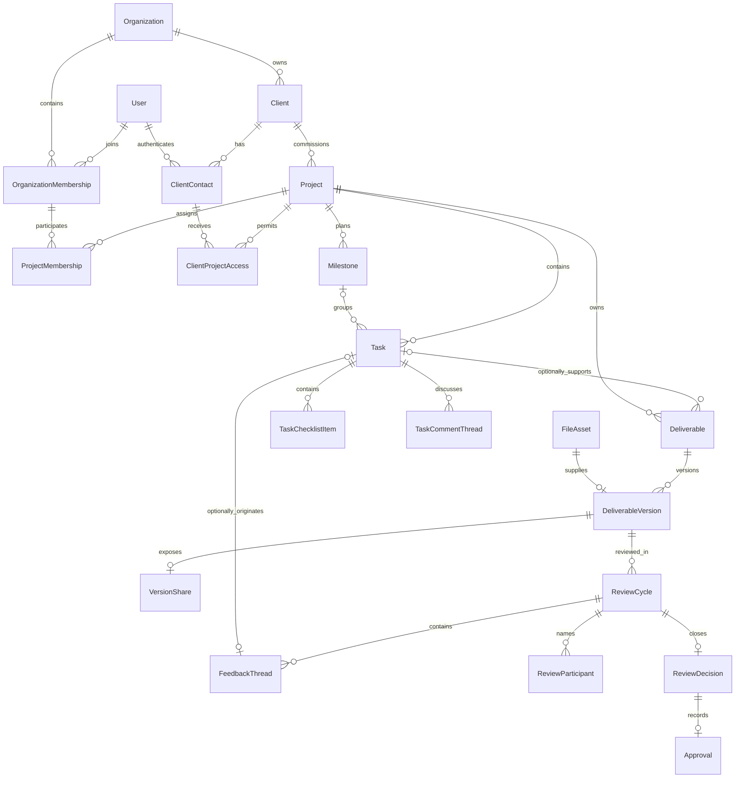
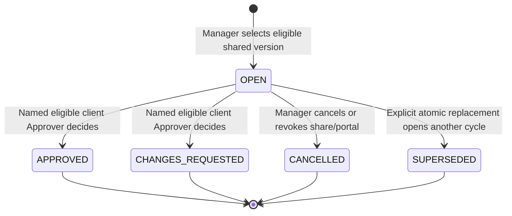

# Data model and state ownership

## Phase 7 implemented ownership

SQL 0035–0043 implements Discussion/DiscussionReply, Document, ClientUpdate and ProjectActivity with mandatory organization/project ancestry, forced RLS, immutable parent/author/history and positive revision/lifecycle guards. Replies reference a same-project topic; archive retains history and blocks replies. Documents store bounded version-1 structured content with SQL shape/size checks; no HTML/styles/embeds. Publication content is immutable; revision-checked withdrawal changes state/time only.

Activity has unique organization/project/event identity and scoped FKs. The existing materializer commits activity, optional notices and receipts together. DISCUSSION/DOCUMENT/UPDATE reuse schema-6 envelopes and audit/actor/request correlation. Default-enabled discussions_documents/client_updates preferences use existing session/CAS/self ports; omitted categories remain unchanged for older clients. Withdrawn notices/feed items fail live visibility. Prisma maps the five new tables; SQL owns constraints/RLS. See [Phase 7 evidence](PHASE_7_REPORT.md).

Current implementation, 2026-10-17: Phases 1–3 accepted; Phase 4 adds Files, Media and immutable Deliverable Versions through migrations 0013–0020. See [Phase 4 report](PHASE_4_REPORT.md). Reviews/preferences and later models remain planned.

## Phase 4 implemented ownership

`project_folder`, `project_upload`, `file_asset`, `file_access`, `file_preview`, `project_file`, `deliverable` and `deliverable_version` use mandatory organization/project ancestry and forced RLS. Flat folders are metadata; they do not change storage ownership or add ACL inheritance. Deliverable has a mandatory Project and nullable same-project Task. Mutable metadata uses revisions; asset/preview/version identities are append-only with immutable byte digest, size, MIME and exact S3 version. The latest-prepared pointer references its own deliverable/version composite key.

Upload intents bind initiator, purpose, opaque staging key, expected bytes/digest/type and expiration. Finalize commits `file_job`/`media_job`; proof-bound five-minute leases and bounded attempts support retry. READY inserts the asset, preview/listing and audit/outbox atomically. `file_processing_step` stores immutable per-lease stage/tool/outcome evidence. A publication interrupted before SQL completion remains private and is retried through exact-key digest verification.

Branding uses `logo_upload/asset/access/reference` with mandatory organization ownership. Own images use separate `profile_upload/asset/access/reference` with mandatory identity ownership and transaction-local self RLS context. No nullable organization is used for project assets. Media attachment is explicit revision-checked pointer replacement; failed/pending uploads preserve the previous image. Removing a pointer does not delete immutable bytes.

`staging_cleanup` is an append-only scoped tombstone with a unique scope/upload key. Locked revalidation permits exact staging deletion only after expiration plus 24 hours and only without an active job or canonical asset. Canonical/version/active image retention and complete restore remain later V08 scope. Prisma maps all twenty new tables; reviewed SQL owns composite constraints, functions, RLS and triggers.

Status: reconciled logical model for review, not a Prisma schema or migration. The architecture direction is provisionally accepted; reconciled relationships/lifecycle defaults are approved for implementation planning. Phase 1 uses only an isolated auth compatibility schema. Final ORM/SQL behavior remains unverified. See [architecture](ARCHITECTURE.md), [product rules](PRODUCT_SPEC.md#product-rules-requiring-explicit-review), and [security](SECURITY.md).

## Modeling rules

1. Use server-generated opaque UUID identifiers. Every tenant-owned row carries nonnullable `organization_id`; project-owned rows also carry `project_id` where needed for enforceable ancestry. Tenant IDs are immutable.
2. A global `id` primary key can coexist with unique `(organization_id, id)` and project-qualified keys. Foreign keys between tenant resources include organization and relevant project/parent IDs. An independent FK on `id` is insufficient.
3. Store UTC instants in timezone-aware PostgreSQL columns. Mutable aggregates have `created_at`, `updated_at`, and positive integer `revision`; conditional updates increment revision. Actor IDs and tenant IDs are assigned by the server.
4. Keep business content identity, access state, processing state, and derived presentation state separate. Do not write an `approved` boolean on Deliverable or FileAsset.
5. Archive ordinary resources to preserve history. Use `RESTRICT` for historical/version/decision references, never broad cascades. Memberships/grants become inactive rather than disappearing. Automated deletion/retention remains subject to V08 and cannot remove referenced approved bytes.
6. Database checks/unique keys/FKs/triggers enforce durable invariants; transactional policies enforce active membership, field permissions, and transitions. RLS enforces tenant scope, not all business policy.

## Relationship overview

Every tenant relationship shown above is qualified by organization; project descendants are additionally project qualified. The diagram omits those repeated key columns and supporting event/security tables for readability.

## Global identity and bootstrap data

Global identity tables have no organization RLS context because authentication precedes tenant selection. They are not ordinary tenant repositories; use a restricted identity adapter/role with self-scoped operations. Do not allow arbitrary user listing from tenant code.

| Entity | Essential fields / relationships | Constraints and ownership |
| --- | --- | --- |
| User | `id`, normalized email, verified timestamp, display name, nullable own profile image asset ID, identity status, credential/security revision | Unique normalized email; profile FK includes owner user ID; Identity owns lifecycle; credential representation follows vetted library |
| Credential / AuthAccount | `user_id`, provider/local password hash, algorithm metadata | Local password login only initially; never expose hashes; uniqueness per library contract |
| Session | `id`, `user_id`, opaque session proof representation, expiry/idle metadata, revoked state, credential revision | Library-owned database sessions; unique proof; role/grants are loaded live, not trusted from cookie snapshots; hash/encryption support must be validated rather than altering library semantics blindly |
| IdentityToken | purpose, intended identity/email, token proof digest, expiry, consumed timestamp | One-time verification/recovery; atomic consume; use library equivalent only after proving secure persistence and race behavior |
| IdentityAudit | actor/subject identity reference, safe action/outcome, time, request ID, bounded network metadata | Append-only, self/security-service scoped; no fake organization for global login failures |
| OnboardingReceipt | `user_id`, operation, key, canonical request hash, result organization reference | Unique `(user_id, operation, key)`; only self access; creates Organization+Owner once in the same transaction |

If Better Auth's actual model differs, map its proven semantics into the identity boundary and update this model/decision register. Token storage, hashing, revocation, and store permissions are explicit validation work, not assumed framework behavior.

Additional global self-owned records reuse Files/events without a tenant-RLS bypass:

| Entity | Essential fields / relationships | Constraints and ownership |
| --- | --- | --- |
| NotificationPreference | `user_id`, category ASSIGNMENTS/REVIEW_ACTIVITY/DISCUSSIONS_DOCUMENTS/CLIENT_UPDATES, channel IN_APP, enabled, revision | Unique user/category/channel; self-only API, narrow delivery-service read for authorized recipient; absent row means enabled; no preference for mandatory identity messages |
| ProfileImageUpload | owner user, generated staging key, expected digest/size/type, expiry/status | Self upload only; no organization/project ID; narrow global adapter, no user enumeration |
| ProfileImageAsset | owner user, upload ID, private canonical/derived keys, digest/type/size/dimensions, processing/access state, ready time | Unique upload/key; canonical metadata immutable at READY; profile pointer must match owner; initially self-only retrieval |
| IdentityIdempotencyRecord | owner user, operation/target, key, request hash, safe result reference/status, expiry | Unique owner/operation/target/key; self-scope reauthorized before replay; supports global image attachment without a fake tenant |
| IdentityOutboxEvent / IdentityEventConsumerReceipt | identity owner, purpose, event ID/schema, bounded payload, lease/attempt/effect state | Existing PostgreSQL/BullMQ mechanics with narrow identity role/interface; allowlisted mail/profile processing only; no fake organization or general user access |

Profile processing/preview records retain the owner user and asset/upload ancestry; sanitized raster variants strip metadata. They do not reference project FileAsset. These global exceptions remain behind self/service policies, never ordinary tenant repositories.

## Organization, client, and access entities

All following entities are tenant-owned. For Organization itself, tenant scope is its `id`.

| Entity | Essential fields / relationships | Constraints and ownership |
| --- | --- | --- |
| Organization | `id`, name, plain-text description, nullable logo asset ID, display timezone, status, revision | First Owner/tenant atomic; logo FK includes organization ID; no public tenant enumeration |
| OrganizationMembership | `organization_id`, `user_id`, role OWNER/ADMIN/MEMBER, ACTIVE/INACTIVE, revision | Unique `(organization_id, user_id)`; lock organization for ownership changes; at least one active Owner enforced by transactional/deferred constraint checks |
| Invitation | tenant, inviter, normalized intended email, purpose INTERNAL/CLIENT, immutable intended org role or contact ID, proof digest, expires/accepted/revoked timestamps | Purpose/target shape check; no role/target edits during acceptance; unique proof; optional partial unique pending invitation by target; expiry checked at use |
| InvitationProjectGrant | tenant, invitation, project, intended internal project role or client access role, client/contact ancestry as applicable | Explicit proposed grants only; validate inviter authority at creation and acceptance; same tenant/client; changes require revocation/new invitation |
| Client | tenant, name, minimal business contact metadata, ACTIVE/ARCHIVED, revision | Client names need not be globally unique; archive blocked while active projects remain |
| ClientContact | tenant, client, intended email, nullable `user_id` until verified acceptance, display name, ACTIVE/INACTIVE, revision | Unique normalized email within client; unique linked user within client; must match verified invited identity; affiliation alone grants nothing |
| Project | tenant, client, name/description, status, portal enabled, deadline, revision | Client is immutable once project has dependent work; changing it requires a separately designed migration, not ordinary edit; FK `(organization_id, client_id)` |
| ProjectMembership | tenant, project, organization membership, MANAGER/CONTRIBUTOR/VIEWER, ACTIVE/INACTIVE, revision | Unique `(organization_id, project_id, membership_id)`; all FKs tenant-qualified; active org membership required at use |
| ClientProjectAccess | tenant, project, client, contact, VIEWER/REVIEWER/APPROVER, ACTIVE/REVOKED, revision | Project/client and contact/client composite FKs enforce the same client; unique project/contact row; active contact and verified identity required at use |

Create explicit unique Project `(organization_id, id, client_id)` and ClientContact `(organization_id, id, client_id)` keys for the corresponding ClientProjectAccess FKs. Do not rely on “we checked the client ID in the controller.” ProjectMembership is the assignment target for tasks; Owner/Admin implicit read/management access does not fabricate a ProjectMembership record. They can add themselves explicitly before being assigned work.

An internal principal is `(user_id, organization_id, membership_id)`; a client principal is `(user_id, organization_id, contact_id)` plus the applicable per-project grant. The API validates this selection. A signed-in user who also has another capacity must select it explicitly; audit records capture the acting capacity.

## Delivery and file entities

| Entity | Essential fields / relationships | Constraints and ownership |
| --- | --- | --- |
| Milestone | tenant, project, title, due time, OPEN/COMPLETED, order, revision | Unique project-qualified identity; completion and linked task writes serialize on milestone/project locks |
| Task | tenant, project, nullable milestone/assignee, title/description, priority LOW/NORMAL/HIGH/URGENT (default NORMAL), status/due/order/revision; nullable source feedback thread added in Phase 5 | Composite milestone/assignee/source FKs include tenant/project; one primary assignee with active internal membership and active MANAGER/CONTRIBUTOR project role; unique nonnull `(organization_id, project_id, source_feedback_thread_id)`; source immutable once set |
| TaskChecklistItem | tenant, project, task, label, order, completed flag, completed_by/at, revision | Same-task composite FK; completion metadata consistent with flag; Manager manages structure, assigned Contributor toggles; no automatic task completion |
| TaskCommentThread / TaskCommentReply | tenant, project, task, thread where applicable, author principal, plain-text body, time | Internal append-only threads/replies; reply FK matches thread/task/project; Managers/Contributors post, Viewers read; no client visibility |
| TaskHistoryEvent | tenant, project, task, event ID/type, actor, safe changed fields/references, occurred time | Append-only in mutation transaction; metadata/assignment/priority/status/checklist/comment/conversion history available from Phase 3; no duplicate comment bodies/secrets |
| ProjectFolder | tenant, project, display name, normalized name, order, revision | One flat level; unique normalized name per project; no parent folder, storage path or ACL; delete only with no referencing file listings |
| UploadIntent | tenant, project, initiator, purpose PROJECT_FILE/DELIVERABLE, random staging key, expected size/digest/type, expires time, status | Project scope nonnullable; unique staging key; bounded completion; sign for public origin, never let clients select keys; processing owned by Files |
| FileAsset | tenant, project, upload intent, canonical key, optional storage version ID, actual SHA-256, byte size, detected MIME, original safe display name, readiness time | Unique intent and canonical key; canonical metadata is immutable once READY; never use multipart ETag as SHA-256; access and processing remain separate |
| FileProcessing | tenant, project, asset/intent, scan/render step, tool version, outcome, attempt, error code, timestamps | Unique logical step/tool version; retries use same identity; changing security assessment cannot rewrite canonical metadata |
| FileAccessState | tenant, project, asset, AVAILABLE/BLOCKED, reason, revision | Security service may block unsafe content without mutating historical version identity; every stream checks this state |
| PreviewAsset | tenant, project, source asset, derived key, page/index, dimensions, format, renderer version | Unique `(asset, renderer_version, page/index)`; private, no overwrite; exact source digest and geometry captured |
| ProjectFile | tenant, project, asset, nullable folder ID (root when null), display title, ACTIVE/ARCHIVED, revision | Asset/folder composite FKs include project; moves only change listing metadata; folder deletion RESTRICT includes archived listings; archive preserves bytes/history |
| Deliverable | tenant, mandatory project, nullable task, title/description, `latest_version_id`, next version number, ACTIVE/ARCHIVED, revision | Nullable task FK includes tenant/project; link/unlink never changes project/tenant; latest pointer is preparation metadata, not the review target or approval eligibility |
| DeliverableVersion | tenant, project, deliverable, positive version number, file asset, file digest/size/type snapshot, creator principal, created time | Unique `(organization_id, deliverable_id, version_number)`; unique attached file asset for version use; all references project-qualified; immutable insert-only row |
| VersionShare | tenant, project, version, ACTIVE/REVOKED, shared/revoked by/time, revision | At most one current share row per version; append audit history for share transitions; grant still required; no implicit sharing from version creation |

Reviewable project files initially support PNG/JPEG/PDF. File/folder metadata never changes canonical storage keys. ProjectFile and DeliverableVersion reference canonical FileAsset bytes; each version's asset identity is immutable. Client project uploads remain outside scope; an authenticated client can upload their own profile image through the separate account-owned path.

| Tenant organization-media entity | Essential fields / relationships | Constraints and ownership |
| --- | --- | --- |
| OrganizationLogoUpload | organization, initiator, staging key, expected digest/type/size, expiry/status | Tenant-scoped without project; Owner/Admin authority; distinct purpose/table from project UploadIntent |
| OrganizationLogoAsset | organization, upload ID, canonical/derived keys, verified digest/type/size/dimensions, processing/access state, ready time | Tenant-qualified unique upload/key/logo FK; no cross-organization attachment; READY canonical metadata immutable |

Logo processing/preview records carry organization and asset/upload ancestry. Logo/profile uploads accept PNG/JPEG only with proposed 2 MiB and validated pixel bounds; scan/normalize to safe raster variants using shared pipeline code and separate scoped persistence. Never add a nullable tenant escape to FileAsset. A ready attachment command atomically updates the organization/user image pointer after rechecking authority; pending/rejected replacements preserve the old pointer. Removal clears the pointer without an unapproved storage purge. Active image references join V08 cleanup/restore protection.

The Deliverable `latest_version_id` points only to its most recently prepared version, with a same-deliverable/project/tenant composite FK (nullable until first version). ReviewCycle.version_id is fixed and need not equal that pointer. SQL may need deferrable parent/latest constraints. Allocate `next_version_number` under the Deliverable lock; never use unlocked `max(number)+1`.

## Reviews, decisions, and feedback

| Entity | Essential fields / relationships | Constraints and ownership |
| --- | --- | --- |
| ReviewCycle | tenant, project, deliverable, version, cycle number, policy ANY_ONE, opener, open/closed time, status, revision; nullable `replaces_cycle_id` | Immutable target/policy/roster; unique version/cycle number; partial unique one OPEN cycle per deliverable; replacement FK matches same deliverable/project/tenant and uniquely identifies its prior cycle |
| ReviewParticipant | tenant, project, cycle, contact, client project grant, REVIEWER/APPROVER eligibility snapshot | Unique cycle/contact; frozen roster; composite references enforce same project/client; current grant/contact state still checked at decision time |
| ReviewDecision | tenant, project, cycle, version, actor principal/contact/grant, APPROVED/CHANGES_REQUESTED, reason, digest snapshot, decided time, idempotency reference | Unique cycle; immutable; actor must be a named currently eligible client Approver; explicit version FK matches cycle version |
| Approval | tenant, project, cycle, version, decision, approved time, approver identity/capacity snapshot, digest | Unique decision and cycle; immutable; composite FK matches decision/cycle/version; deferred constraint/trigger requires an APPROVED decision and matching cycle state |
| FeedbackThread | tenant, project, cycle, version, author principal, visibility INTERNAL/CLIENT, body, optional annotation, created time | Immutable target/visibility/initial body; parent FK matches cycle/version; clients cannot create INTERNAL visibility or see it |
| FeedbackReply | tenant, project, thread, author, body, created time | Append-only; policy requires open cycle for new feedback/replies; client visibility inherited from thread |
| FeedbackResolutionEvent | tenant, project, thread, RESOLVED/REOPENED, actor, internal safe note, time | Append-only; Managers/Contributors may mark addressed even after closure; resolution is not a review decision; internal notes never appear to clients |

Participants distinguish who can make a formal decision; active project Reviewers may add client-visible feedback even when not named Approvers. A selected Approver's later promotion/demotion/revocation does not rewrite the frozen roster or historical decision. It affects eligibility for future actions immediately.

Annotation is a typed validated payload: `IMAGE_PIN {x,y}` or `PDF_POINT {page,x,y}`. `x,y` are normalized coordinates in [0,1] against the canonical orientation/unrotated displayed page; PDF page is a positive 1-based index bounded by verified page count. Store source digest plus source dimensions/page box in the preview metadata; transform zoom/scroll/rotation consistently in the UI. No cross-version annotation copying or pixel offsets that drift on zoom. Rectangles/freehand/text-range annotations are not required by this baseline.

### Review state machine and version ownership

- Creating N+1 updates immutable history and the latest-prepared pointer; sharing N+1 updates its share. Neither modifies N's open cycle, feedback or eligibility. No version DRAFT/PUBLISHED states are added.
- Opening explicitly selects a ready/available shared version of an active project with portal enabled and frozen ANY_ONE roster including at least one active named client Approver. Owner/Admin or Manager may open; no other OPEN cycle may exist. A newer prepared/shared version is not a rejection condition.
- Decision checks exact displayed cycle/version/digest, expected revision and live authority. Insert one immutable ReviewDecision; APPROVED also inserts Approval, closing the cycle with audit/outbox atomically. Reviewed SQL constraints/triggers enforce terminal decision/approval shape. CHANGES_REQUESTED requires a reason. Being newest/shared does not allow approval without a cycle.
- **Replace active review:** require old OPEN cycle/revision and an explicitly selected newer ready/available/already shared, never-approved version of the same Deliverable, its digest and valid new roster. Under shared locks, set old cycle SUPERSEDED and insert a new OPEN cycle with `replaces_cycle_id`; commit audit/outbox/idempotency together. Never retarget a cycle. Failure preserves the old OPEN cycle and creates no partial replacement.
- Enforce unique `(organization_id, replaces_cycle_id)` when nonnull. A reviewed deferred constraint verifies that every SUPERSEDED cycle has exactly one same-deliverable successor, that a replacement points to its SUPERSEDED source, and that the successor target version number is greater. The successor may later become terminal; it is not required to remain OPEN forever.
- A decision and replacement have one winner: replacement first rejects the stale decision; decision first rejects replacement, requiring a refreshed separate open-cycle action. Preparation/sharing and the old decision may both succeed. Uniqueness/idempotency prevent duplicate replacement effects.
- Terminal cycles never reopen. With no OPEN cycle, a Manager can explicitly select any otherwise eligible shared version never approved for a new cycle, including after cancellation/change request/supersession; prior cycles remain terminal. Already approved versions cannot be reviewed again; use a new version. Replacement itself requires a newer target than its source cycle.
- CANCELLED/SUPERSEDED have no Decision/Approval. Portal disable, target-share revoke, or project/deliverable archive cancels affected open cycles; project completion rejects OPEN cycles. Grant revocation removes future authority; no eligible contacts leaves a blocked cycle until Manager action. Historical decisions persist.
- Approval derives per exact version, never from the latest-prepared pointer. An older approval stays historical evidence; another version needs its own approval. UI distinguishes active-review target from newest prepared/shared bytes and hides unshared metadata from clients. Replacement preserves historical shares until separately revoked.
- Closed-cycle feedback is read-only except append-only internal resolution events. Managers may convert readable closed feedback to an internal task in an active project without altering the cycle. Conversion/resolution never counts as approval.

### Task details, source feedback and safe content

Checklist/comment/history descendants repeat tenant/project/task ancestry in constraints. New assignment requires active internal membership plus an active MANAGER/CONTRIBUTOR project role; a VIEWER or client contact cannot be assigned. Role downgrade/removal clears or reassigns active tasks atomically and records history. Managers administer checklist structure/priority/assignment; current assigned Contributors toggle completion and permitted work state. Managers/Contributors may comment on accessible tasks; Viewers read. Checklist completion is independent of DONE. Metadata/checklist changes use expected revisions and append TaskHistoryEvent atomically; task history exists before Phase 7 general ProjectActivity.

Phase 5 adds Task.source_feedback_thread_id with a same-project composite FK and permanent unique nonnull source index. A thread creates at most one converted task. Task, initial history, audit/outbox and idempotency receipt commit together. Same-key/matching-payload retries reauthorize and replay; a reused key with different payload returns 409 Conflict. Another key for the same source returns 409 Conflict, exposing an existing-task reference only after current task visibility authorization, without altering fields. The source reference is immutable, survives task archive and appears only in internal DTOs. Clients receive no task backlink or conversion marker. Independent manual tasks remain possible without falsely reusing this conversion link.

Nullable Deliverable.task_id uses a same-tenant/project FK when present; null never makes Project optional. Manager link/unlink preserves project, versions and review history. Linked tasks cannot be hard-deleted into orphan references; archival preserves them.

Documents store a versioned, bounded allowlisted rich-text JSON tree: text/paragraph/heading/list nodes and bold/italic/link marks, safe HTTP(S) links, no arbitrary HTML/styles/embeds. A small visual editor serializes it; pasted content is normalized to supported formats or plain text. Rendering escapes text through explicit components. Implement/verify in Phase 7; no editor library is selected by this baseline.

## Collaboration, communications, and reliability data

| Entity | Essential fields / relationships | Constraints and ownership |
| --- | --- | --- |
| Discussion / DiscussionReply | tenant, project, topic/thread, author, text, status, timestamps | Internal only; same-project references; archived topics reject replies |
| Document | tenant, project, title, content schema version, bounded rich-text JSON, ACTIVE/ARCHIVED, revision | Allow paragraphs/headings/text, ordered/unordered lists, bold/italic/safe links only; validate depth/length/protocols server-side, render explicit safe components; optimistic save; no raw HTML/styles/embeds |
| ClientUpdate | tenant, project, Manager author, sanitized body, PUBLISHED/WITHDRAWN, times, revision | Explicit publication; client DTO omits internal fields; history retained |
| Notification | tenant, recipient user + acting capacity/contact, category, event, resource reference, read timestamp | Unique recipient/event/kind; live permission and optional category preference checked before materialization; reads reauthorize; no capacity merge |
| ProjectActivity | tenant, project, event ID, allowlisted event type, actor display snapshot, safe summary, occurred time | Unique event/project projection; client updates are a separate filtered view, never the whole activity table |
| AuditEvent | tenant, optional project, actor type/reference/capacity, action, target, safe before/after metadata, outcome, time, correlation ID | Append-only; worker-generated events identify system purpose and initiating actor; no credentials/content dumps |
| OutboxEvent | tenant, event ID, type/schema, aggregate ID/revision, actor, minimal payload, time, lease/dispatch state | Created transactionally with important mutation; immutable envelope; dispatch state mutable only by narrow dispatcher interface |
| EventConsumerReceipt | tenant, event, handler, logical effect, state/attempt/lease/error/time | Unique `(organization_id, event_id, handler)`; domain effect + receipt commit together where possible; supports reconciliation |
| IdempotencyRecord | tenant, actor capacity, operation/target, key, canonical request hash, safe result ref/status, expiry | Unique scoped key; concurrent command serialization; authorize before replay; permanent constraints outlive TTL |

Resource references in notifications/audit/events can be tagged IDs without a conventional FK only when the target kind is explicit and the writer validates ancestry. They must not become unscoped generic lookup endpoints. Payloads are minimized and serialized through allowlists.

## Other lifecycle rules

| Aggregate | States / transitions | Owner and concurrency rule |
| --- | --- | --- |
| Project | PLANNED → ACTIVE → COMPLETED → ARCHIVED; COMPLETED → ACTIVE by explicit reopen; PLANNED/ACTIVE → ARCHIVED by explicit archive | Manager/Owner/Admin; completion requires no unfinished noncancelled tasks and no OPEN reviews; approval is not automatically required for every deliverable. Archiving cancels open cycles as an explicitly confirmed transition |
| Task | TODO, IN_PROGRESS, BLOCKED, DONE, CANCELLED; Manager can manage all, assigned Contributor can move among working states and DONE | Work module; conditional revision; CANCELLED and administrative fields Manager-only; archived project blocks updates |
| Milestone | OPEN ↔ COMPLETED | Completion requires all noncancelled linked tasks DONE; no eligible tasks permits explicit completion only; adding/reopening eligible work atomically reopens milestone |
| UploadIntent | ISSUED → UPLOADED → PROCESSING → READY; EXPIRED, REJECTED, FAILED terminal/retry-aware paths | Files; expired intent cannot finalize; transient FAILED can be retried under a bounded new attempt; malicious REJECTED cannot |
| FileAsset | canonical metadata fixed at READY | Files; access blocking/processing attempts live outside immutable metadata |
| Deliverable | ACTIVE → ARCHIVED | Managers; latest-prepared pointer changes on version creation, never active-review eligibility; archive cancels open reviews; no version deletion |
| VersionShare | absent → ACTIVE ↔ REVOKED | Manager; revocation cancels open cycle and removes client read access, historical facts remain |
| Membership/contact/grant | ACTIVE ↔ INACTIVE or REVOKED | Authorized manager/admin boundary; history remains; no automatic restoration of old sessions or review eligibility beyond frozen roster checks |

Proposed completion policy permits projects without deliverables and does not require client approval for every task. New work in a COMPLETED project requires reopening. A task may omit milestone and has one optional primary assignee; a Deliverable always belongs to a project and may omit task. These defaults and deliberate replacement were accepted in the Phase 1 authorization.

## Integrity, concurrency, and indexes

- Define checks for positive version/cycle/revision numbers, nonnegative byte sizes, valid normalized annotation bounds, terminal timestamps, and purpose-specific invitation targets.
- Enforce tenant/project chains for Task→Milestone/ProjectMembership/source FeedbackThread, checklist/comment/history→Task, nullable Deliverable→Task, ProjectFile→Folder/Asset, Version→Deliverable/Asset, Cycle→Version/replaced Cycle, Participant→Cycle/Grant, Decision/Approval→Cycle/Version, Feedback→Cycle/Version. Logo/global-profile references use their separate non-project owner-qualified constraints.
- Immutable version/decision/approval rows deny runtime UPDATE/DELETE through grants and protective triggers. Canonical file metadata cannot mutate after readiness. Audit envelopes and sensitive event envelopes are append-only; operational states live separately where appropriate.
- Sensitive commands serialize in a documented order: Organization (only for org-wide role/ownership changes), Project, relevant membership/contact/grant/share rows, Deliverable, ReviewCycle, then Work aggregates in stable ID order as needed. Any command requiring multiple such locks follows the same order. Ordinary Work writes lock Project then Milestone(s) then Task to preserve completion checks. Do not lock a Deliverable before its access records in the same workflow.
- Decisions versus explicit replacement and grant/share/portal revocation, preparation versus valid decisions, duplicate conversion/replacement/version creation, folder moves, checklist edits and last-owner demotion need real parallel tests. Retry database aborts only for bounded idempotent commands, never blindly repeat storage/mail effects.
- Index scoped tenant/project lists, task priority/assignee/due filters, checklist/comment/history task lookups, unique feedback origin, folder/file membership, active membership/contact/grant lookups, version sequence, cycle state/replacement, recipient category/unread and event leases. Filter permissions before client-update aggregation/counts. Add only query-driven indexes beyond integrity keys and verify plans later.
- Retention jobs may remove only expired unbound upload/staging artifacts after a validated grace period and reference check. Never race READY/version attachment with cleanup: serialize asset attachment/cleanup claims and retain a tombstone/receipt. Backups must cover database plus referenced canonical/preview objects, with checksums and restore verification.

## State ownership summary

Identity owns authentication, own image reference and preferences; Organizations owns tenant/team/settings/logo reference; Access owns policy; Work owns task/milestone/checklist/comment/history and feedback conversion; Deliverables owns optional task linkage and immutable versions/latest-prepared pointer; Reviews owns fixed-target cycles/replacement/decisions; Files owns folders/scoped media; History owns audit/projections; Communications owns notifications/aggregate updates. Web, Redis, sockets and badges are never domain truth.

### Feedback-to-task duplicate contract

For the same authorized actor/scope, the same idempotency key and matching payload replay the original result after authorization. A reused key with a different payload returns 409 Conflict. The same source thread with a different key returns 409 Conflict; include an existing-task reference only if that actor is still authorized to see that task. Client principals never receive internal task references. Permanent source uniqueness and transaction/concurrency protection remain mandatory. This is a Phase 5 contract, not Phase 1 application functionality.

## Phase 1 schema boundary

The only implemented schema is the disposable V01 fixture under packages/database/prisma/experiment, mapping four library auth tables plus one digest-only v01_email_proof issuance/consumption receipt in devworkspace_v01. The existing session row has lastActivityAt; atomic expiry/activity checks use database time normalized to UTC. The receipt adds one-time semantics around the library's issued verification JWT, without another credential authority. The product model, tenant constraints, production migrations and RLS remain planned. See the [Phase 1 report](PHASE_1_REPORT.md); this is not tenant integrity or V02 evidence.

## Phase 3 implemented schema and lifecycle mapping

Migrations `0010-core.sql`, `0011-client-access.sql`, `0012-core-bindings.sql` are additive to the retained Phase 2 database and checksummed by the existing preparation command. No product database rename/reset or historical migration rewrite occurs. The ten new tables map to the logical Client, ClientContact, Project, ProjectMembership, ClientProjectAccess, Milestone, Task, TaskChecklistItem, TaskCommentThread/Reply and TaskHistoryEvent entities above. Thread roots have a null `thread_id`; replies reference a root in the same tenant/project/task. All are forced-RLS tables. Mutable rows have positive revisions and UTC creation/update times. Scope/parent triggers reject ordinary reparenting; comments/history are insert-only for the runtime role.

Task and milestone changes share the organization lock with membership revocation. SQL backstops validate active assignees, reopen completed milestones on unfinished work, prevent completion with unfinished noncancelled tasks, and clear active task assignments when internal participation is removed/downgraded. Completed task assignments remain historical; reopening requires a currently eligible assignee or explicit clearing. Contact deactivation revokes existing client grants and pending invitations; reactivation does not restore them.

Phase 3 extends Invitation with `purpose`, `contact_id`, `project_id`, `project_role`; shape constraints and an immutable-target trigger separate internal from client targets. ClientProjectAccess composite foreign keys match both project and contact to one client. Verified acceptance links `ClientContact.user_id` and only its proposed project grant, never Membership. Linked contact email cannot be changed through ordinary edits. Public lists never expose that global identity link. Project client association is immutable through ordinary commands. Projects with incomplete work cannot complete; new work in completed projects requires explicit reopen. Archived history stays readable through current access.

Recovery remains forward-only: preserve the private credential/mail key and migration ledger, rerun `pnpm phase2:prepare` to verify hashes and apply missing migrations, and add a new repair migration if needed. Never edit applied 0010-0012 or run `db push`/reset against retained data. Full backup/restore remains Phase 9.

## Phase 5 persistence implementation

Additive SQL 0021–0027 owns review/share/feedback tables, forced tenant RLS, qualified FKs, permanent source/decision uniqueness, append-only history, deferred state/digest/actor consistency and transaction-frozen roster. `task.source_feedback_thread_id` is set only by the internal conversion command at insertion and cannot be replaced/cleared. Portal disable, target share revocation and project/deliverable archive cancel OPEN cycles with audit/outbox effects in the resource transaction; re-enabling never reopens them. Terminal history survives. Completion rejects OPEN reviews. ReviewCycle due_at is an informational deadline, not expiry. Grant/session/identity/portal/share/security state gates live access. See [Phase 5 report](PHASE_5_REPORT.md) and D20 in [Architecture](ARCHITECTURE.md).

## Phase 6 persistence implementation

SQL 0028–0034 adds immutable schema-6 event context for future events, forced-RLS recipient/capacity notifications and a separate global identity preference table accessed only through session-bound self functions. Historical envelopes remain schema 1 and are not backfilled. Notification ancestry matches its actual event's organization/project/type/target/action/time. Unique recipient/event/capacity/category keys and immutable history permit only a first read timestamp update. The durable notifications-v6 consumer receipt commits with all recipient effects or rolls back with them; skipped preferences also consume the event, preventing retrospective backfill. Assignment snapshots refer to ProjectMembership and resolve to its actual active Membership/user.

Existing delivery leases, bounded attempt budgets and audited exhausted replay remain authoritative after Redis loss. Claim attempts are not external-send counters. Completion requires the schema-6 materializer receipt; bounded jitter delays failed attempts. Content-free `delivery_details` exposes operational states without domain content. No separate event stream or public authority token is introduced. The [Phase 6 report](PHASE_6_REPORT.md) records exact interfaces, role grants, tests and recovery limits.
